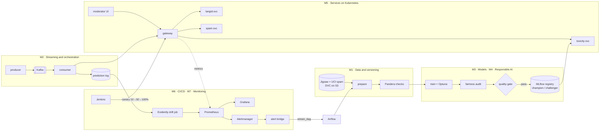

# ModeraGuard

**Multi-model comment moderation with fairness auditing and drift-triggered retraining.**
MLOps course project (4CS104DE25), group of seven.

ModeraGuard detects the language of each comment, scores it for toxicity and spam, and decides
`allow`, `review` or `block`. Around those models sits a complete MLOps loop: versioned data,
tracked experiments, a model registry, a fairness-aware quality gate, containerised services on
Kubernetes with canary releases, monitoring, and automatic retraining when live comments drift
away from the training data.



## Contents

- [Results](#results)
- [Quick start (one laptop)](#quick-start-one-laptop)
- [Demo: the closed loop](#demo-the-closed-loop)
- [Cloud deployment](#cloud-deployment)
- [Repository structure](#repository-structure)
- [Team and contributions](#team-and-contributions)
- [How the course syllabus maps to the project](#how-the-course-syllabus-maps-to-the-project)
- Docs: [contracts](docs/contracts.md) · [data](docs/DATA.md) · [contributing](docs/CONTRIBUTING.md) ·
  [model card](docs/model_card.md) · [fairness report](docs/fairness_report.md) · [runbook](docs/runbook.md) ·
  [demo script](docs/demo.md)

## Results

Numbers below are from the **synthetic sample data** (`data/sample/`), which the repo ships so the
whole system runs without downloads. The sample deliberately contains annotator bias and slang that
appears only after mid-2017, so fairness and drift effects are visible. Replace them with the real
Jigsaw and UCI numbers after running on the real data ([docs/DATA.md](docs/DATA.md)).

**Toxicity models** (test set, 1,295 comments)

| Model | AUC | F1 | Precision | Recall | Worst false-positive gap across groups |
| --- | --- | --- | --- | --- | --- |
| Logistic regression, no bias mitigation | 0.998 | 0.933 | 0.903 | 0.965 | 0.68 |
| **Logistic regression, with mitigation (champion)** | 0.994 | 0.958 | 0.981 | 0.935 | 0.29 |
| Linear SVM, with mitigation (challenger) | 0.991 | 0.967 | 1.000 | 0.935 | 0.00 |

Bias mitigation (counterfactual augmentation plus re-weighting) costs 0.004 AUC and cuts the worst
false-positive gap from 0.68 to 0.29. The score for *"Good to see {group} represented in the
discussion"* varies by 0.56 across five groups without mitigation, and by 0.04 with it.

**Retraining after drift** (newer comments use slang the first model never saw)

| | AUC, older comments | AUC, newer comments | Recall on newer toxic comments |
| --- | --- | --- | --- |
| Champion before retraining | 0.994 | 0.954 | 0.88 |
| After the drift-triggered retrain | 0.994 | 0.998 | 0.96 |

Drift detection on the same data: the Evidently job flags 80–100% of monitored features as drifted
on the newer comments and 0% on a second sample of training-era comments.

## Quick start (one laptop)

Needs Docker Desktop with about 8 GB of RAM given to it, and Python 3.12.

**Windows (PowerShell):** use `.\make.ps1` instead of `make`. Every task has the same name.

```powershell
git clone https://github.com/<your-org>/moderaguard.git
cd moderaguard
.\make.ps1 doctor      # checks Docker, Compose and Python
.\make.ps1 up          # builds and starts all services (first build takes a while)
.\make.ps1 bootstrap   # trains every model and registers it in MLflow (about 2 minutes)
.\make.ps1 smoke       # two test comments through the gateway
.\make.ps1 stream      # start streaming comments through Kafka
```

If PowerShell says running scripts is disabled, run this once:
`Set-ExecutionPolicy -Scope CurrentUser RemoteSigned`, then `Unblock-File .\make.ps1`.
Keep the repo outside OneDrive (e.g. `C:\dev\moderaguard`): OneDrive syncing locks
files that Docker, Git and DVC are using.

**macOS / Linux:** the same tasks through `make`:

```bash
make up && make bootstrap && make smoke && make stream
```

Local URLs

| Service | URL | Login |
| --- | --- | --- |
| Gateway API (Swagger) | http://localhost:8000/docs | |
| Moderator UI | http://localhost:8501 | |
| MLflow | http://localhost:5000 | |
| Airflow | http://localhost:8080 | admin / admin |
| Grafana | http://localhost:3000 | admin / admin |
| Prometheus | http://localhost:9090 | |
| Alertmanager | http://localhost:9093 | |

Working on the Python code only (no Docker):

```powershell
py -3.12 -m venv .venv ; .venv\Scripts\Activate.ps1     # macOS/Linux: python3.12 -m venv .venv && source .venv/bin/activate
.\make.ps1 install       # or: make install
.\make.ps1 pipeline      # dvc repro: data -> validation -> training -> fairness -> quality gate
.\make.ps1 test          # ruff + pytest
```

## Demo: the closed loop

The full script, with who presents what, is in [docs/demo.md](docs/demo.md). In short:

1. `make stream`: training-era comments flow producer → Kafka → consumer → gateway. Grafana shows
   traffic, verdicts and a low drift score.
2. A pull request goes through GitHub Actions; after merge, Jenkins trains, runs the quality gate,
   builds and scans the images, and rolls the challenger out as a 10% canary. Grafana compares
   canary and stable side by side.
3. `make drift`: the producer switches to the newer comments. The drift job (every 10 minutes in
   Airflow) pushes a high drift share, Prometheus fires `ModelDriftDetected`, Alertmanager calls the
   alert bridge, and the bridge starts Airflow's `retrain_dag`.
4. `retrain_dag` retrains on the newly labelled comments, re-scores the champion on the same test
   set, audits fairness, and passes the quality gate only if the new model is at least as accurate
   *and* at least as fair. It registers the model as `@challenger` and asks Jenkins for a canary.
5. `make canary-weight W=50`, then `make promote`, or `make rollback` if the canary misbehaves.

## Cloud deployment

One VM (4 vCPU, 16 GB RAM, Ubuntu 24.04; Azure for Students or GCP credits). Platform services
(Postgres, S3, MLflow, Kafka, Airflow) run in Docker Compose; serving and monitoring run on k3s,
with the Kubernetes Gateway API (Traefik) handling canary traffic splits.

```bash
sudo bash infra/cloud/setup-vm.sh     # Docker, k3s, image registry, Jenkins, secrets
docker compose up -d postgres s3 s3-init mlflow kafka airflow consumer
docker compose run --rm trainer       # first models
make k8s-monitoring                   # Prometheus, Grafana, Alertmanager on the cluster
# then run the 'moderaguard' job in Jenkins (http://<VM_IP>:8081): it builds and deploys
```

After that: API `http://<VM_IP>/docs`, UI `http://<VM_IP>/ui`, Grafana `http://<VM_IP>/grafana`.
Details and troubleshooting are in [docs/runbook.md](docs/runbook.md).

## Repository structure

```
src/moderaguard/        shared Python package
  data/                 prepare, validate (Pandera), sample generator           M1
  features/             text cleaning + TF-IDF                                  M1
  models/               train, tune (Optuna), register (MLflow), rescore        M3
  responsible/          fairness, quality gate, explanations, PII redaction     M4
  serving/              model loader + Prometheus metrics shared by services    M5
services/
  gateway/              public moderation API                                    M5
  model-service/        one image, three services (toxicity, spam, langid)      M5
  moderator-ui/         Streamlit moderator screen                               M4
  producer/, consumer/  Kafka clients                                            M2
  drift-job/            Evidently drift detection                                M7
  alert-bridge/         Alertmanager -> Airflow retraining                       M7
pipelines/airflow/dags/ ingest, drift check, retrain                             M2
k8s/                    base, overlays (local, cloud, canary), monitoring        M5, M6, M7
monitoring/             Prometheus rules + tests, Alertmanager, Grafana          M7
infra/                  MLflow, Postgres, S3, Airflow, Jenkins, CI, cloud VM     M1, M3, M6
tests/                  unit, data, model (behavioural), API                     everyone
dvc.yaml, params.yaml   reproducible pipeline and its settings                   M1, M3
Jenkinsfile             CI/CD pipeline                                           M6
docker-compose.yml      full local stack                                         M5
```

## Team and contributions

Each member owns one part of the lifecycle and at least one running service. Every change reached
`main` through a reviewed pull request; see the Insights → Contributors page and the closed issues.

| Member | Role | Owns | Key files |
| --- | --- | --- | --- |
| M1 — *name* | Data and versioning | DVC + S3 remote, Pandera validation, features, sample data, repo setup | `src/moderaguard/data/`, `features/`, `dvc.yaml`, `infra/seaweedfs/` |
| M2 — *name* | Orchestration and streaming | Kafka producer/consumer, Airflow DAGs | `services/producer/`, `services/consumer/`, `pipelines/airflow/`, `infra/airflow/` |
| M3 — *name* | Models and experiment tracking | Training, Optuna, MLflow server and registry | `src/moderaguard/models/`, `infra/mlflow/`, `infra/trainer/` |
| M4 — *name* | Responsible AI and governance | Fairness audit, mitigation, quality gate, explanations, redaction, moderator UI, model card | `src/moderaguard/responsible/`, `services/moderator-ui/`, `docs/model_card.md` |
| M5 — *name* | Model services and containers | Gateway, model services, Dockerfiles, Compose, Kubernetes base, HPA | `services/gateway/`, `services/model-service/`, `docker-compose.yml`, `k8s/base/` |
| M6 — *name* | CI/CD and cloud delivery | Jenkins, GitHub Actions, Trivy, k3s VM, canary rollout | `Jenkinsfile`, `.github/`, `infra/jenkins/`, `infra/cloud/`, `k8s/overlays/` |
| M7 — *name* | Monitoring and retraining | Prometheus, alert rules, Grafana, Evidently drift job, alert bridge | `monitoring/`, `services/drift-job/`, `services/alert-bridge/`, `k8s/monitoring/` |

## How the course syllabus maps to the project

| Unit | Topic | Where |
| --- | --- | --- |
| I | MLOps lifecycle | The whole loop above |
| II | Version control for code, data and models | Git flow, DVC, MLflow registry with aliases |
| III | Data pipelines, feature engineering | `prepare`, Pandera, TF-IDF pipeline, Airflow |
| IV | Containers and orchestration | Docker multi-stage builds, Compose, Kubernetes, HPA |
| V | Deployment patterns, message passing | Gateway API canary + header A/B, Kafka |
| VI | Monitoring, drift, explainability | Prometheus, Grafana, Evidently, occlusion explanations |
| VII | CI/CD and testing for ML | GitHub Actions, Jenkins, data/model/behavioural tests, quality gate |
| VIII | Responsible AI, governance, privacy | Fairness audit + mitigation, model card, PII redaction, Trivy |

| Lab | Practical | Where |
| --- | --- | --- |
| 1 | Git and GitHub for ML code and data | PR workflow, `.github/CODEOWNERS`, DVC for data |
| 2 | REST API for a model | `services/gateway`, `services/model-service` |
| 3 | Docker | One Dockerfile per service, `docker-compose.yml` |
| 4 | Feature engineering, hyperparameter tuning, data pipeline | TF-IDF features, Optuna (`models/tune.py`), `dvc.yaml` |
| 5 | Jenkins CI/CD | `Jenkinsfile`, `infra/jenkins/` |
| 6 | MLflow tracking, versioning, packaging, serving | Runs, registry aliases, pyfunc models served by alias |
| 7 | Prometheus: server, web application and database | node-exporter, service `/metrics`, postgres-exporter |
| 8 | Grafana | `monitoring/grafana/` |
| 9 | Kubernetes with many microservices | `k8s/` (seven services, canary, HPA) |
| 10 | Cloud implementation | `infra/cloud/setup-vm.sh`, `k8s/overlays/cloud` |
